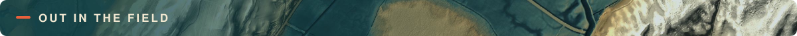
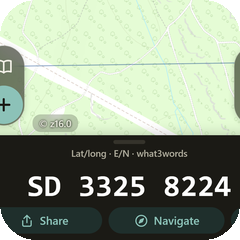
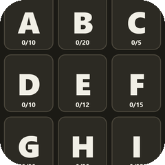
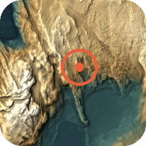
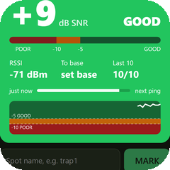
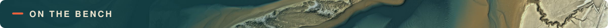
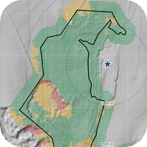
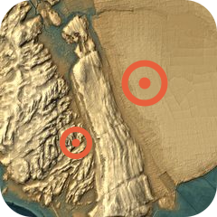
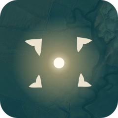

 

Hi, I'm Nick.

I spend my days on nature reserves in South Lakeland, Cumbria, with some lovely people, looking after rare and endangered species (**dormice, red squirrels, ospreys**) and managing the habitats they live in.

In the evenings I learn about, tinker with, and build technical things that make that work easier.

*Dry stone waller, reserves ranger, map nerd, and that guy who brings a laptop to the bog.*

 

<table>
<tr>
<td width="110"></td>
<td><b><a href="https://nickjsykes.github.io/gridref/">Field Notes</a></b> Pocket map and notebook for rangers. Grid refs, conversions, offline maps and sharing.</td>
</tr>
<tr>
<td></td>
<td><b><a href="https://nickjsykes.github.io/boxcheck/">Box Check</a></b> Scientific quick capture recorder. Big buttons, easy flow.</td>
</tr>
<tr>
<td></td>
<td><b><a href="https://github.com/nickjsykes/threat-detector">Threat Detector</a></b> Screens every week's planning applications against ancient woodland and the Ancient Tree Inventory, automatically.</td>
</tr>
<tr>
<td></td>
<td><b><a href="https://nickjsykes.github.io/canopy-ranger/">Canopy Ranger</a></b> Diagnostic tool for Canopy network.</td>
</tr>
</table>

<table>
<tr>
<td width="110"></td>
<td><b><a href="https://www.canopysensors.co.uk/">Canopy</a></b> Low cost LoRa sensors for traps, feeders & nest security.</td>
</tr>
<tr>
<td></td>
<td><b>Warden</b> Early warning for nature reserves: planning, felling, permits and satellite change, turned into one weekly brief with a deadline on every line.</td>
</tr>
<tr>
<td></td>
<td><b>MothCam</b> A Mothbox-style moth camera trap, building and testing with AMI.</td>
</tr>
</table>

 

I build these with AI coding assistants. I am not a professional developer.

LiDAR: Environment Agency 1 m DTM, © Environment Agency, Open Government Licence v3.
