<picture>
  <source media="(prefers-color-scheme: dark)" srcset="banner-dark.svg">
  
</picture>

 

Hi, I'm Nick.

I spend my days on nature reserves with some lovely people, looking after rare and endangered species (dormice, red squirrels, ospreys) and managing the habitats they live in.

In the evenings I learn, tinker, and build technical things that make that work easier.

Dry stone waller, reserves ranger, day dreamer and that guy who brings a laptop to the bog.

### Out in the field

| | |
|---|---|
| **[Field Notes](https://nickjsykes.github.io/gridref/)** | Pocket map and notebook for rangers. Grid refs, conversions, offline maps and sharing. |
| **[Box Check](https://nickjsykes.github.io/boxcheck/)** | Scientific quick capture recorder. Big buttons, easy flow. |
| **[Threat Detector](https://github.com/nickjsykes/threat-detector)** | Screens every week's planning applications against ancient woodland and the Ancient Tree Inventory, automatically. |
| **[Canopy Ranger](https://nickjsykes.github.io/canopy-ranger/)** | Diagnostic tool for Canopy network. |

### On the bench

- **Canopy**: LoRa sensor network.
- **Warden**: Early warning for nature reserves: planning, felling, permits and satellite change, turned into one weekly brief with a deadline on every line.
- **MothCam**: A Mothbox-style moth camera trap, building and testing with AMI.

I build these with AI coding assistants. I am not a professional developer.

Banner: Environment Agency 1 m LiDAR, © Environment Agency, Open Government Licence v3.